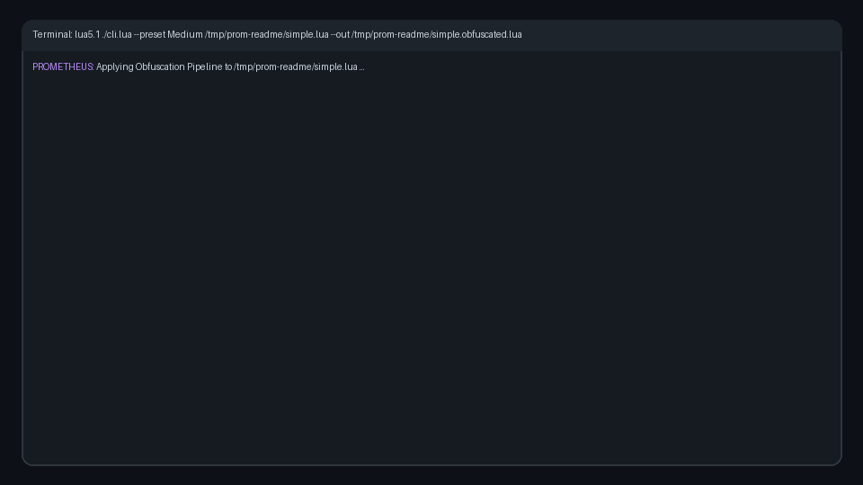

<div align="center">


<a href="https://github.com/prometheus-lua/Prometheus">
  
</a>

<br/>

<a href="https://prometheus-lua.github.io/Prometheus/">
  
</a>
<a href="https://github.com/prometheus-lua/Prometheus/actions/workflows/Test.yml">
  
</a>
<a href="https://github.com/prometheus-lua/Prometheus/stargazers">
  
</a>
<a href="https://discord.gg/U8h4d4Rf64">
  
</a>

</div>

---

<p align="center">
  
</p>

**Prometheus** is a Lua obfuscator written in pure Lua.

It applies a range of **AST-based transformations** to make source code significantly harder to read, analyze, and reverse engineer.  
These include **register VM virtualization**, **control-flow flattening**, **constant encryption**, **opaque predicates**, **dead code injection**, and other Lua-specific obfuscation strategies.

The project was inspired by the excellent [javascript-obfuscator](https://github.com/javascript-obfuscator/javascript-obfuscator).

Currently, Prometheus supports:

- **Lua 5.1**
- **LuaU** *(basic support is available, but still not fully finished)*

Lua 5.1's legacy implicit `arg` table in vararg functions is unsupported.
Use `...` and `select('#', ...)` instead; see [Limitations](doc/reference/limitations.md).
Replacing a function's environment while it is running is also unsupported;
set the environment before calling the function.

---


## Quick Start

Try the browser version first:


<a href="https://prometheus-lua.github.io/Prometheus/">
  
</a>

### Install CLI (Linux/macOS)

Install latest release with one command:

```bash
curl -fsSL https://raw.githubusercontent.com/prometheus-lua/Prometheus/master/install.sh | sh
```

Then use the CLI directly:

```bash
prometheus-lua --version
prometheus-lua --preset Medium ./your_file.lua
```

The release bundle includes a Lua runtime, so no separate Lua install is required for the packaged CLI.

To update to the latest release:

```bash
prometheus-lua update
```

To uninstall:
```bash
rm -f ~/.local/bin/prometheus-lua && rm -rf ~/.local/share/prometheus-lua
```

### Local source usage

```bash
git clone https://github.com/prometheus-lua/Prometheus.git
cd Prometheus
lua cli.lua --preset Medium ./your_file.lua
```

---

## Obfuscation Steps

Prometheus includes **27 obfuscation steps** that can be combined in any order:

| Step | Description | Performance Impact |
|------|-------------|-------------------|
| **Vmify** | Compiles functions into register instructions executed by a generated Lua VM | High |
| **Cff** | Flattens control flow into randomized block dispatchers | Medium-High |
| **EncryptStrings** | Encrypts all string literals with a custom PRNG-based cipher | Low |
| **StringToBytes** | Converts strings to `string.char()` calls with byte sequences | Low |
| **ConstantArray** | Extracts constants into a shuffled/rotated array | Low |
| **NumbersToExpressions** | Replaces number literals with equivalent expressions | Low |
| **OpaquePredicates** | Inserts mathematically always-true conditions with dead else branches | Low |
| **DeadCodeInjection** | Injects realistic-looking code paths that never execute | Low |
| **ProxifyLocals** | Wraps local variables in proxy table objects | Medium |
| **SplitStrings** | Splits strings into concatenated chunks | Low |
| **AntiTamper** | Adds runtime integrity checks that break the script if modified | Low |
| **WrapInFunction** | Wraps the entire script in nested function calls | Low |
| **AddVararg** | Adds vararg to all function signatures | Negligible |
| **MultiLayerEncryption** | Encrypts strings through multiple algorithm layers (XOR, Caesar, substitution, CBC) | Low-Medium |
| **ConstantUnfolding** | Replaces numeric/boolean constants with runtime-computed expressions | Low |
| **CallIndirection** | Redirects global calls through an encrypted dispatch table | Low |
| **BogusControlFlow** | Inserts fake control-flow paths with interconnected opaque predicates | Low-Medium |
| **EnvironmentChecks** | Runtime anti-debugging, timing analysis detection, and stdlib integrity checks | Low |
| **SelfChecksum** | Runtime self-integrity verification using sentinel values and function structure | Low |
| **BytecodeEncryption** | Encrypts bytecode segments with runtime decryption | Medium |
| **DummyCode** | Inserts realistic dummy functions and variables | Low |
| **OpcodeSubstitution** | Replaces standard operations with equivalent complex expressions | Low |
| **StringMorph** | Morphs string operations through encoding transformations | Low |
| **MBAObfuscation** | Replaces arithmetic with mixed boolean-arithmetic expressions | Low |
| **TableIndirection** | Redirects variable access through indirection tables | Low-Medium |
| **Watermark** | Embeds a hidden watermark in the code | Negligible |
| **WatermarkCheck** | Adds runtime watermark verification | Low |

## Presets

| Preset | Steps | Use Case |
|--------|-------|----------|
| **Minify** | None (rename only) | Smallest output, no obfuscation |
| **Weak** | CFF + ConstantArray + OpaquePredicates + WrapInFunction | Light protection, low overhead |
| **Medium** | VM + Encryption + AntiTamper + CFF + Numbers + DeadCode + Opaques | Balanced protection |
| **High** | VM + Encryption + AntiTamper + Opaques + DeadCode + CallIndirection + CFF + ConstantUnfolding + Numbers + StringToBytes + BogusControlFlow + EnvironmentChecks + OpcodeSubstitution + DummyCode + StringMorph | Strong protection, moderate overhead |
| **Strong** | VM + MultiLayerEncryption + AntiTamper + Opaques + DeadCode + CallIndirection + CFF + ConstantUnfolding + Numbers + StringToBytes + BogusControlFlow + EnvironmentChecks + SelfChecksum + OpcodeSubstitution + MBA + DummyCode + BytecodeEncryption + StringMorph + TableIndirection | Heavy protection |
| **Maximum** | All steps at max settings including MBA, OpcodeSubstitution, TableIndirection | Maximum protection, highest overhead |

> **Reliability note:** `Minify`, `Weak`, and `Medium` are verified to produce runnable output across varied inputs and are the presets exposed in the web playground / upload page. `High`, `Strong`, and `Maximum` stack many advanced transforms and can fail on some scripts; treat them as experimental and test their output before relying on it.

## Web playground &amp; server-side obfuscation

The `web/` app is a Vite + React playground that obfuscates Lua in the browser via wasmoon. It also includes:

- An **Upload page** (`#/upload`) where dropping a `.lua` file obfuscates it automatically.
- A **serverless `/api/obfuscate` endpoint** (`web/api/obfuscate.ts`) that runs the obfuscator server-side via wasmoon, for Vercel deployment. Set a `DATABASE_URL` env var (Neon / Supabase / any Postgres) to persist uploads; it is optional and never blocks a response.

Deploy on Vercel with the project **Root Directory set to `web`** (the included `web/vercel.json` configures the build and the function).

## Name Generators

| Generator | Style | Example |
|-----------|-------|---------|
| **MangledShuffled** | Shuffled alphanumeric (default) | `xK9_mQ`, `aR2bF` |
| **Mangled** | Sequential alphanumeric | `a`, `b`, `aA` |
| **Il** | Confusing I/l/1 mix | `IlI1l`, `l1Il1` |
| **Number** | Numeric prefixed | `_1`, `_42` |
| **Confuse** | Real-looking names | `index_factory`, `loader_parse` |
| **Hex** | Memory address style | `_0x4f2a`, `loc_89dc` |
| **Chinese** | CJK Unicode characters (LuaU) | `万丁三`, `上下不` |
| **Homoglyph** | Unicode lookalikes of Latin letters (LuaU) | `аbс`, `ΑΒΓ` |

---

## Documentation

You can find the full documentation, including the getting started guide, here:

<p align="center">
  <a href="https://prometheus-lua.github.io/Prometheus/docs/">
    
  </a>
</p>

Contribution guidelines: [CONTRIBUTING.md](CONTRIBUTING.md)

---

### Requirements

Packaged CLI releases include a bundled Lua runtime.
For source usage, Prometheus requires **LuaJIT** or **Lua 5.1+**.

Lua 5.1 binaries can be downloaded here:  
https://sourceforge.net/projects/luabinaries/files/5.1.5/Tools%20Executables/

---

## Example

### Input

```lua
-- input.lua
print("Hello, World!");
```

### Obfuscated output

```lua
-- input.obfuscated.lua
return(function(...)local L={"afT6mf1V","/7mJXsuvmE1c/fT3";"tn1ZSn6=","37ghSJM=";"WqermfWAWuuZpb3XX7M=","tqXGSJ3u","XQXpL9x21dxAWJa//p==","SrM=";"3q+5SJM=","/D==";"t7XUt0p=";"mIeOmIx9";"LdgrBfWdWuNABsb+KJxj","SJWJ4dahKsebW7t+KQv=","/cDu3AvP/D==";"Llv7uD==","tJWhFfTE";"TQ43ctIuy9HIop==","mEu93p==";"WJax1sXEXEaxWuxGt6==","t0gPSEp=",...
-- remaining obfuscated output omitted
```

### CLI Options

```bash
# List all available presets
prometheus-lua --list-presets

# List all available obfuscation steps
prometheus-lua --list-steps

# Use a specific preset
prometheus-lua --preset High ./input.lua

# Set output path
prometheus-lua --preset Medium --out ./output.lua ./input.lua

# Reproducible output with a fixed seed
prometheus-lua --preset Medium --seed 12345 ./input.lua

# Generate a source map for debugging
prometheus-lua --preset Medium --source-map output.map ./input.lua

# Quiet mode (errors only)
prometheus-lua --preset Medium -q ./input.lua

# Verbose mode (debug output)
prometheus-lua --preset Medium --verbose ./input.lua

# Force Lua 5.1 target
prometheus-lua --preset Medium --Lua51 ./input.lua

# Force LuaU target
prometheus-lua --preset Medium --LuaU ./input.lua
```

For more advanced use cases, configuration, and presets, see the [documentation](https://prometheus-lua.github.io/Prometheus/docs/).

---

## Tests

The test suite runs existing cases on Lua 5.1 and Luau, plus the adapted
official Lua 5.1 suite on Lua 5.1, inside Docker:

```bash
./scripts/run-tests.sh           # Run all tests (default: 10 iterations)
./scripts/run-tests.sh -b        # Build image and run tests
./scripts/run-tests.sh -n 5      # Run with 5 iterations
./scripts/run-tests.sh -c config.lua  # Use a custom config
./scripts/run-tests.sh -v        # Verbose output
./scripts/run-tests.sh --suite upstream --baseline-only  # Verify official originals
./scripts/run-tests.sh --case lua51/closure.lua --preset Cff --seed 4 -n 1
```

---

## Community

Prometheus has an official Discord server:

<p align="center">
  <a href="https://discord.gg/U8h4d4Rf64">
    
  </a>
</p>

---

## License and Commercial Use

Prometheus is licensed under the **Prometheus License**, a modified MIT-style license.

You are free to use, modify, and distribute this software, including for commercial purposes, under the following conditions:

- Any commercial product, wrapper, or service *(including SaaS or hosted solutions)* that uses or integrates Prometheus must include clear attribution to:

```text
Based on Prometheus by Elias Oelschner, https://github.com/prometheus-lua/Prometheus
```

- The attribution must be visible in the product’s:
  - UI
  - documentation
  - public website
- The obfuscated output files generated by Prometheus do **not** need to include any license or copyright notice.
- Derivative works and public forks must also include a statement in their README noting that they are based on Prometheus.

Full license text: [Prometheus License](https://github.com/prometheus-lua/Prometheus/blob/master/LICENSE)

---

<div align="center">


</div>
